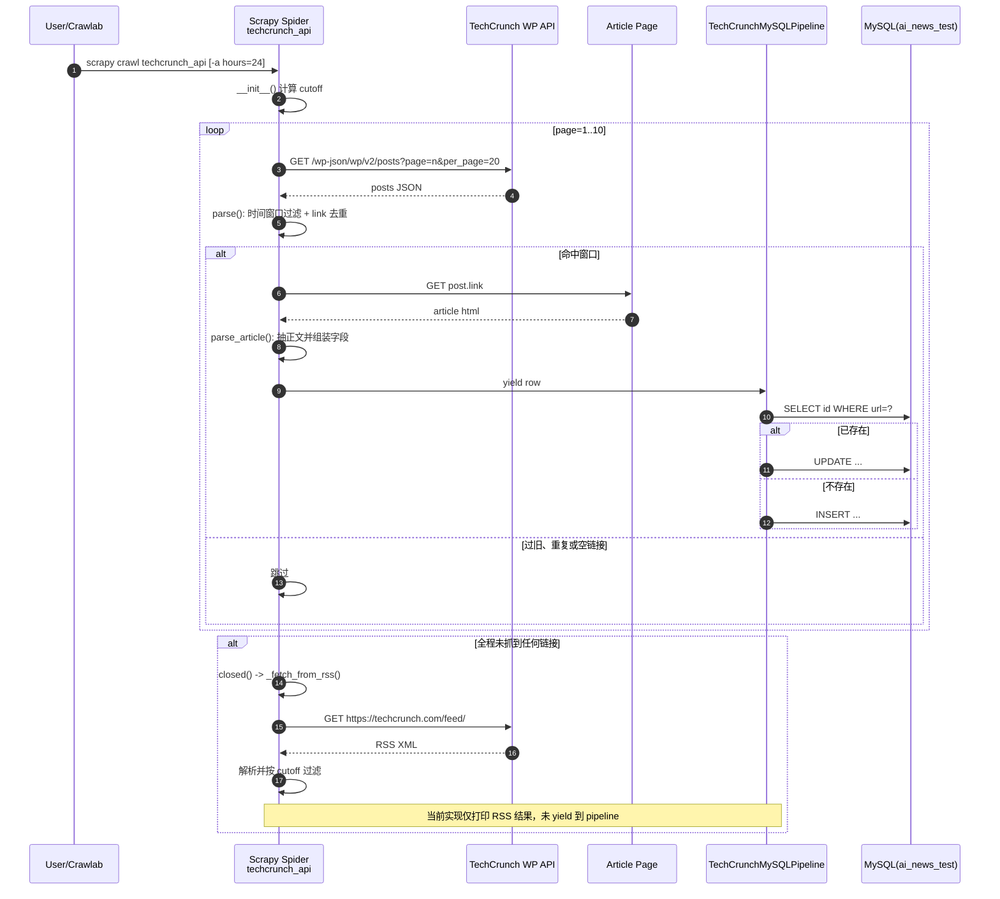

# Crawlab 工程导读

## 1. 工程概览

`crawlab-news` 目录承载的是一套 **Crawlab 平台部署环境 + Scrapy 爬虫项目集合**。

这套工程主要解决三件事：

1. 使用 Docker 启动 Crawlab 管理端与 MongoDB。
2. 在 Crawlab 中统一创建、上传和调度爬虫任务。
3. 当前以 `news` 作为主要维护和运行的 Scrapy 项目。

如果只想快速理解这个目录，可以先把它看成三层：

- 平台层：负责运行 Crawlab。
- 项目层：负责承载具体 spider 和数据处理逻辑。
- 任务层：负责把 spider 命令注册到 Crawlab 并执行。

---

## 2. 目录结构

### 2.1 根目录关键文件

- `docker-compose.yml`：定义 Crawlab master 与 MongoDB 的启动方式。
- `Dockerfile.crawlab`：在官方 Crawlab 镜像基础上补充爬虫运行依赖。
- `BUILD.md`：镜像构建、平台启动和基础操作说明。
- `docs/crawlab_overview.md`：当前这份工程导读。

### 2.2 项目目录

- `news`：当前主项目，承载多源科技与投资资讯抓取。
- 本工程只维护 `news`。交易所 MNA 采集在独立工程维护；news 内的并购邮件报告不依赖该独立工程。

---

## 3. 平台启动与运行链路

### 3.1 平台启动

平台启动流程以 `BUILD.md` 为准，核心步骤可以概括为：

1. 构建自定义 Crawlab 镜像。
2. 执行 `docker compose -p crawlab up -d --build master mongo`。
3. 查看 `master` 日志，确认服务已经正常启动。

### 3.2 `docker-compose.yml` 中的关键点

- `master` 服务暴露端口 `18803:8080`。
- `mongo` 服务端口绑定 `127.0.0.1:27017`。
- 数据持久化目录为 `./.crawlab/master` 和 `./.crawlab/mongo/data`。

### 3.3 Crawlab 中任务的本质

在 Crawlab 里，一个任务最终仍然是执行一条命令，典型形式如下：

```bash
scrapy crawl <spider_name>
```

例如在 `news/.crawlab_tasks.map` 中，已经记录了部分任务映射：

- `techcrunch_api` -> `scrapy crawl techcrunch_api`
- `a16z`、`bvp`、`hongshan`、`thomabravo`、`crunchbase`、`techstartups`、`email_report` -> 各自的 `scrapy crawl` 命令

也就是说，Crawlab 主要负责：

- 维护任务定义。
- 提供调度入口。
- 承接运行日志与任务上下文。

真正的数据抓取逻辑仍然在 Scrapy 项目内部。

---

## 4. `news` 项目说明

`news` 是当前这套工程里真正成熟、也最值得优先阅读的部分。按目录现状看，它已经不是单一新闻源 spider，而是一组围绕科技新闻、投资机构动态和创投资讯构建的 Scrapy 项目。

### 4.1 实际目录结构

`news` 根目录下当前可以分成四类内容：

- `scrapy.cfg`：Scrapy 项目入口，默认指向 `news.settings`。
- `news/`：核心代码目录，包含 `items.py`、`settings.py`、`pipelines.py`、`middlewares/`、`utils/` 和 `spiders/`。
- `azure_ai.py`：独立的 AI 丰富化模块，负责英文摘要、翻译和标签分类。
- `Makefile` 与 `.crawlab_tasks.map`：用于 Crawlab 项目创建、更新和任务 ID 映射。

其中 `news/spiders/` 目录下当前实际存在的 spider 包括：

- `techcrunch_api`
- `techcrunch_venture`
- `techstartups`
- `a16z`
- `bvp`
- `hongshan`
- `thomabravo`
- `crunchbase`

从这个结构可以看出，`news` 的定位已经更接近“多源科技/投资资讯采集项目”，而不是早期单站点抓取脚本。

### 4.2 当前实现的两条处理链路

结合 `settings.py`、`pipelines.py` 和各 spider 的 `custom_settings`，这个项目当前实际并行存在两条数据链路。

第一条是老链路，主要由全局 `ITEM_PIPELINES` 驱动：

- `DefaultValuesPipeline`
- `HandlePubDatePipeline`
- `HandleCleanTextPipeline`
- `HandleCleanTitlePipline`
- `HandleStatusPipeline`
- `MongoPipeline`

这条链路更偏历史实现，目标是做基础字段补全、文本清洗、发布时间规范化，并最终写入 MongoDB。

第二条是当前更活跃的新链路：

- 多个 spider 在各自的 `custom_settings` 中直接启用 `news.pipelines.TechCrunchMySQLPipeline`。
- 同时挂上 `crawlab.scrapy.pipelines.CrawlabPipeline`，让 Crawlab 的任务数据页与 MySQL 入库结果保持一致。
- `TechCrunchMySQLPipeline` 会把结果写入 `AI_NEWS_MYSQL` 配置对应的 MySQL 表，并根据需要调用 `azure_ai.py` 做摘要、翻译、标签分类等 AI 丰富化。

这意味着当前 `news` 的真实状态不是“只有一个通用 pipeline”，而是“保留旧 Mongo 方案，同时以 MySQL + AI 丰富化作为新的主通道”。

### 4.3 Spider 实际分组

按当前代码实现方式，大致可以把 spider 分成三类：

1. 基于 WordPress API 的站点
   - `techcrunch_api`
   - `techstartups`

   这类 spider 通常直接请求站点的 `wp-json/wp/v2/posts` 接口，再进入文章详情页补全正文和作者等字段。

2. 基于 RSS 的站点
   - `techcrunch_venture`
   - `crunchbase`

   这类 spider 先从 feed 拉取近期文章，再回到详情页抽取正文内容。

3. 基于列表页 HTML 解析的站点
   - `a16z`
   - `bvp`
   - `hongshan`
   - `thomabravo`

   这类 spider 先抓列表页，再基于链接模式筛选文章 URL，最后抓详情页做正文抽取。

`crunchbase` 现从官方 FeedBurner 全文 RSS 读取新闻（https://feeds.feedburner.com/CrunchbaseNews），沿用原文链接、发布日期和全文；直连站点 feed 作为备用。订阅内容正常进入 AI 与 MySQL/Crawlab pipeline，不再依赖关闭钩子发起 RSS 请求，也不强制把数据库地址改为公网 IP。`bvp` 读取新版 Atlas 的公开 Next.js 数据；`thomabravo` 使用当前新闻与 Behind the Deal 入口。默认时间窗口仍为 36 小时，没有近期文章时输出 0 条属于正常筛选结果。

### 4.4 数据模型与输出方向

`news/items.py` 里当前最值得关注的是 `TechCrunchNewsItem`。这个 Item 的字段设计已经明显偏向统一新闻表输出，包括：

- 中文标题、英文标题
- 链接、网站、发布日期、作者、标签
- 中英文内容摘要
- 中英文 AI 摘要
- 完整英文内容

这也和 `TechCrunchMySQLPipeline` 的职责一致，说明当前项目的演进方向是把多个新闻源统一归一到单张新闻表，而不是只保留原始网页抓取结果。

### 4.5 与 Crawlab 的实际对接状态

当前 `.crawlab_tasks.map` 登记了 9 条已有远端任务，根目录 `scripts/update_news.py` 提供跨平台批量更新入口。

当前能确认的情况是：

- 已登记 `techcrunch_api`、`a16z`、`bvp`、`hongshan`、`thomabravo`、`crunchbase`、`techstartups`、`email_report`、`panews`。远端 `Spiders` 对应 `panews`，保留其显示名称。
- 未提供 ID 的条目不参与批量更新；新增映射时核对真实 ID，避免重复创建任务。
- `Makefile` 提供了 `create`、`update`、`show-ids` 等上传命令，但 `NEWS_SPIDERS` 变量里仍包含 `bloomberg`、`techcrunch` 等与当前文件列表不完全一致的名字。

从根目录运行 `python scripts/update_news.py` 预览，`--check-remote` 只读核对线上目标，`--execute` 上传；news 目录下可使用 `make plan-update-all` / `make update-all`。工具使用 Python 标准库直接访问 API，读取 `crawlab.server.json` 和本机 `~/.crawlab/cli/config.json`，无需安装 CLI。上传前核对所有目标及命令，逐文件校验 MD5；只更新文件，保留远端任务配置，不触发任务。

### 4.6 推荐阅读顺序

如果目标是快速看懂这个项目，建议按下面顺序阅读：

1. `news/news/spiders/techcrunch_api.py`
   这是最完整、最容易理解的一条主线实现。
2. `news/news/pipelines.py`
   重点看旧 Mongo 链路与 `TechCrunchMySQLPipeline` 的分工。
3. `news/azure_ai.py`
   理解摘要、翻译、标签分类如何接入数据流。
4. `news/news/spiders/a16z.py`、`crunchbase.py`、`hongshan.py`
   看不同站点是如何分别处理列表页、反爬限制和详情解析的。

---

## 5. `techcrunch_api` 任务链路与排查

`techcrunch_api` 是当前最适合作为排障样本的 spider，因为它覆盖了：

- API 分页抓取。
- 时间窗口过滤。
- 详情页抽取。
- MySQL 入库。
- RSS 兜底逻辑。

### 5.1 时序图



### 5.2 关键可配置项

- 抓取时间窗：`hours`
  - 示例：`scrapy crawl techcrunch_api -a hours=72`
- API 翻页范围：`start_requests` 中的 `range(1, 11)` 与 `per_page=20`
- 入库连接：`AI_NEWS_MYSQL_*` 环境变量
  - 包括 `host`、`port`、`user`、`password`、`db`、`table`

### 5.3 常见故障定位

#### 有抓取日志，但数据库没有数据

- 先检查 `TechCrunchMySQLPipeline connect failed` 相关日志。
- 确认任务环境变量 `AI_NEWS_MYSQL_HOST`、`AI_NEWS_MYSQL_PORT`、`AI_NEWS_MYSQL_USER`、`AI_NEWS_MYSQL_PASSWORD`、`AI_NEWS_MYSQL_DB` 是否正确。

#### 抓不到新文章

- 检查 `hours` 是否设置过小。
- 检查 API 是否出现页码越界、限流或返回异常。

#### RSS 兜底有输出，但没有入库

- 这是当前代码的既有行为。
- RSS 分支只执行 `print`，没有 `yield row` 给 pipeline，因此不会进入 MySQL 入库流程。

### 5.4 代码定位

- Spider 主体：`news/news/spiders/techcrunch_api.py`
- MySQL 入库：`news/news/pipelines.py` 中的 `TechCrunchMySQLPipeline`

### 5.5 更新 `techcrunch_api` 代码

该任务已经存在，无需再次创建。从 `crawlab-news` 根目录执行：

```bash
python scripts/update_news.py --names techcrunch_api --check-remote
python scripts/update_news.py --names techcrunch_api --execute
```

如果在 `news` 目录且有 make，也可以执行 `make update NAME=techcrunch_api`；`make show-ids` 查看本地任务映射。

只有新增且尚不存在的任务才使用 `make create NAME=<name> CMD="scrapy crawl <name>"`，该创建入口仍需安装并配置 Crawlab CLI。既有任务的更新使用 API 工具，不需要 CLI。

---

## 6. 维护建议

从当前结构看，后续维护时最值得优先处理的点有：

- 将数据库连接信息统一改为环境变量注入，避免长期保留明文配置。
- 统一 UTF-8 编码与终端显示设置，减少中文字段或注释乱码问题。
- 给 `a36kr` 等未完成 spider 标注状态，避免在 Crawlab 中被误当成可稳定运行任务。
- 为关键 pipeline 增加最小化测试，至少覆盖字段映射、去重和入库 SQL 生成。

---

## 7. 一句话总结

如果把这套工程压缩成一句话：它是一个以 Crawlab 为调度外壳、以 Scrapy 项目为执行核心、以 `news` 为当前主干实现的爬虫工作目录。